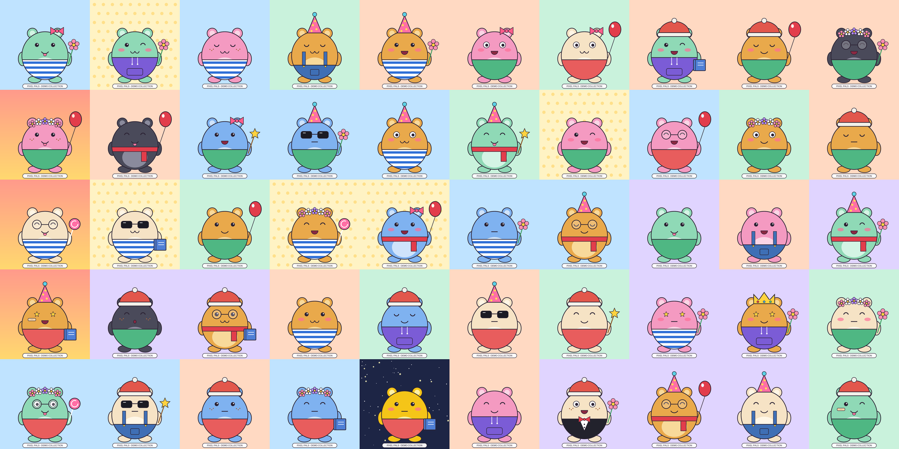

# Pixel Pals - demo generative collection

A small, self-made **demo project** that shows a complete generative-collection pipeline:
layered artwork -> weighted random traits -> compatibility rules -> unique images + metadata + rarity report.

This is a portfolio/demo collection, not a commercial client project. The characters and all
layers are original and are drawn by `make_layers.py`. The demo set is 1,000 images at 1000 x 1000 px;
the same script and config scale to 10,000 images at 2000 x 2000 px.



## What it does

- **8 trait groups**: Background, Body, Clothes, Mouth, Eyes, Face, Head, Items (53 layers)
- **Rarity weights** per trait in `config.json`
- **"None" option** for Face, Head and Items
- **Compatibility rules** (e.g. umbrella never with headwear, sunglasses never over rare eyes)
- **Logo as a separate overlay layer**, always composited on top so it is fully visible on every background
- **No duplicates**: every combination gets a DNA hash, repeats are rejected
- **Reproducible**: same seed + same config = identical collection
- Outputs: PNGs, one metadata JSON per image, `_metadata.json`, `metadata.csv`, `rarity_report.md`, `rarity.csv`, contact sheet of 50 previews

## Run it

```bash
pip install -r requirements.txt
python make_layers.py                         # draws the layer PNGs (already included in layers/)
python generate.py --count 50 --out samples   # 50 previews for approval
python generate.py --count 1000 --seed 2026   # full demo collection -> output/
```

1,000 images render in about one minute on 4 CPU cores.

## Files

| Path | Content |
|---|---|
| `config.json` | layer order, rarity weights, compatibility rules, overlay (logo) |
| `generate.py` | generator: picking, uniqueness check, rendering, metadata, rarity report |
| `make_layers.py` | draws the demo artwork layers |
| `layers/` | one folder per trait group, transparent full-canvas PNGs |
| `samples/` | 50 preview images with metadata and contact sheet |
| `output/` | results of the 1,000-image run: `metadata.csv`, `_metadata.json`, `rarity_report.md`, `rarity.csv` (images are regenerated by the script) |

## Using it with other artwork

Export each layer of the PSD as a full-canvas transparent PNG into `layers/<Group>/<Trait>.png`,
list the traits and weights in `config.json`, set `"size": 2000`, and run `generate.py --count 10000`.
